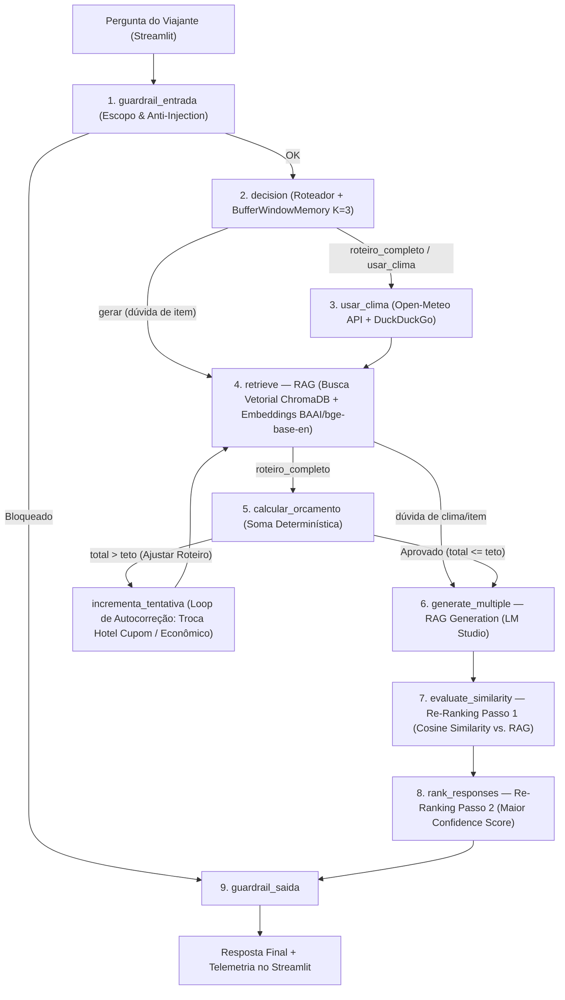

# 🏔️ Planejador Inteligente de Viagens para Santiago — Agentic RAG, Re-Ranking e LangGraph

Sistema de **Agentic RAG com Re-Ranking e Autocorreção de Orçamento** desenvolvido com **LangGraph**, **ChromaDB**, **HuggingFace Embeddings (`BAAI/bge-base-en`)**, **LM Studio (`hermes-3-llama-3.2-3b@q6_k`)**, **Pydantic (`ChunkMeta`)** e **Streamlit**.

O agente atua como um consultor especializado em pacotes de 4 dias para **Santiago do Chile**, combinando base de conhecimento curada da agência, previsão meteorológica em tempo real (**Open-Meteo API**), cálculo financeiro determinístico e **loop de autocorreção condicional** para garantir que o roteiro sempre caiba no orçamento do viajante (`casal`, `familia` ou `individual`).

---

## 🎯 Problema Resolvido

Um LLM puro usado no atendimento de uma agência de viagens apresenta três limitações críticas que este projeto resolve:

1. **Conhecimento curado sem alucinação (Nó Guia — RAG + Re-Ranking):** Consulta documentos reais da agência sobre **Hotéis, Passeios e Restaurantes em Santiago**, validados na ingestão com `Pydantic` (`ChunkMeta`), indexados no **ChromaDB** com embeddings normalizados `BAAI/bge-base-en` e ranqueados por similaridade de cosseno (`cosine_similarity`).
2. **Dados em tempo real (Nó Clima & Web):** Consulta a previsão do tempo de 4 dias em Santiago via **Open-Meteo API** (gratuita, sem chave) e busca complementar via **DuckDuckGo**, orientando passeios ao ar livre (`ar_livre_sol`) para dias ensolarados e atrações cobertas (`coberto_qualquer_clima`) para dias nublados ou chuvosos.
3. **Precisão matemática e Loop de Autocorreção (Nó Financeiro + Aresta Condicional do LangGraph):** Soma de forma determinística `hospedagem + passeios + gastronomia/traslados`. Quando o roteiro inicial ultrapassa o teto do cliente (ex.: **R$ 5.200 > R$ 5.000**), a aresta condicional retorna automaticamente ao Nó Guia e substitui pelo **Hotel Parceiro com Cupom da Agência (R$ 1.950)**, reduzindo o pacote para **R$ 4.650** (folga de **R$ 350**). Caso o orçamento informado seja inferior ao menor pacote disponível na agência, o sistema informa claramente a impossibilidade e exibe o valor mínimo necessário.

---

## 🏗️ Arquitetura do Grafo (`Agentic RAG + Re-Ranking + LangGraph`)



---

## 📂 Estrutura do Projeto

```text
planejador-viagens-santiago-agentic-rag/
├── dados_origem/
│   ├── hoteis_santiago.json         # Hotéis curados em Santiago (Lastarria, Providencia)
│   ├── passeios_santiago.json       # Passeios curados (Vinícolas, Teleférico, Museus, Parques, Neve)
│   └── restaurantes_santiago.json   # Pacotes gastronômicos (Bocanariz, Tiramisú, Giratorio, Mestizo, Mercados)
├── rag/
│   └── chroma_db/                   # Banco vetorial persistido pelo ChromaDB
├── docs/
│   └── superpowers/
│       ├── specs/
│       │   └── 2026-11-16-santiago-agentic-rag-design.md
│       └── plans/
│           └── 2026-11-16-santiago-agentic-rag-plan.md
├── cria_rag.py                      # Validação Pydantic (ChunkMeta), chunking e criação do ChromaDB
├── worker_atualiza_precos.py        # Worker gratuito (Câmbio CLP->BRL) que atualiza os JSONs e reindexa o RAG
├── executa_agentic_rag.py           # Web App Streamlit + Grafo LangGraph completo
├── requirements.txt                 # Dependências Python do projeto
└── README.md                        # Documentação do projeto
```

---

## 📋 Contrato de Dados (`ChunkMeta` — Pydantic)

Cada item em `dados_origem/*.json` é validado antes de entrar no banco vetorial:

```python
class ChunkMeta(BaseModel):
    id_item: str
    nome: str
    categoria: Literal["hospedagem", "passeio", "restaurante"]
    bairro: str
    perfil: list[Literal["casal", "familia", "individual"]]
    faixa_preco: Literal["baixo", "medio", "alto"]
    clima: Literal["ar_livre_sol", "coberto_qualquer_clima", "neve_inverno"]
    preco_brl: float = Field(gt=0)
    preco_clp_base: int = Field(gt=0)
    parceiro_cupom: bool = False
    descricao: str
    ultima_atualizacao: str
```

---

## 🚀 Como Executar Localmente

### 1. Pré-requisitos
- **Python 3.12** (recomendado via Anaconda/Miniconda)
- **LM Studio** (gratuito em [lmstudio.ai](https://lmstudio.ai/)) com o modelo `hermes-3-llama-3.2-3b@q6_k` carregado e servidor local ativo em `http://localhost:1234/v1` *(o sistema também conta com fallback determinístico caso o LM Studio esteja desligado)*.

### 2. Instalação das Dependências
```bash
conda create --name santiago python=3.12 -y
conda activate santiago
pip install -r requirements.txt
```

### 3. Criação do Banco Vetorial (`ChromaDB`)
```bash
python cria_rag.py
```

### 4. (Opcional) Executar o Worker de Câmbio (`CLP -> BRL`) e Reindexação
```bash
# Modo demonstração (atualiza câmbio e carimbo de data preservando os preços do caso base):
python worker_atualiza_precos.py

# Modo live (recalcula preco_brl nos JSONs pela cotação do dia):
python worker_atualiza_precos.py --live
```

### 5. Iniciar a Aplicação Web no Streamlit
```bash
streamlit run executa_agentic_rag.py
```
Acesse no navegador: **http://localhost:8501**

---

## 💡 Exemplos de Perguntas para Testar

1. **Ativando o Loop de Autocorreção (R$ 5.200 → R$ 4.650):**
   > *"Planeje um roteiro de 4 dias em Santiago para casal com orçamento máximo de R$ 5.000, considerando o clima."*
2. **Testando a Memória `Buffer K=3` no turno seguinte:**
   > *"Estará ensolarado nesse pacote?"*
3. **Roteiro para Família com ajuste automático até R$ 3.000:**
   > *"Quero um roteiro para família até R$ 3.000,00"*
4. **Roteiro para Viajante Individual:**
   > *"Vou viajar sozinho (individual) para Santiago por 4 dias com orçamento de R$ 3.500. O que recomenda?"*
5. **Testando limite mínimo (Orçamento Insuficiente):**
   > *"Quero um pacote de 4 dias em Santiago até R$ 2.000,00"*

---

## 🙏 Créditos e Referência

Arquitetura base de Re-Ranking e Agentic RAG inspirada no **Projeto 3** do curso *Construção e Deploy de Agentes de IA* (**Data Science Academy**), expandida com validação Pydantic (`ChunkMeta`), integração meteorológica em tempo real (`Open-Meteo`), memória conversacional (`Buffer K=3`), cálculo financeiro determinístico com loop de autocorreção no `LangGraph` e worker de câmbio `CLP -> BRL`.
